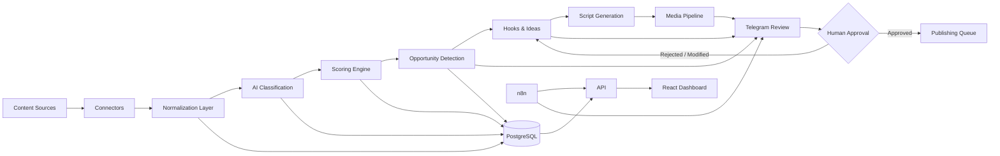

# AI Marketing Automation Engine

> **Public showcase repository** for an AI-powered digital marketing automation platform focused on content intelligence, opportunity scoring, content generation, video production, and human-approved publishing workflows.


## Overview

**AI Marketing Automation Engine** is an end-to-end platform designed to help transform raw content signals into structured marketing opportunities.

The system ingests content from supported sources, normalizes and classifies it with AI, calculates configurable opportunity scores, generates hooks, ideas and scripts, assists with multimedia production, and sends selected items through a **human review and approval flow** before publication.

The project was designed as a modular MVP that can evolve into a broader marketing intelligence and content operations platform.

## What the platform does

- Collects and normalizes content from multiple data sources.
- Detects trends and potential content opportunities.
- Classifies content using interchangeable AI providers.
- Calculates configurable marketing and virality scores.
- Generates hooks, ideas, scripts, prompts, and content packages.
- Sends ranked opportunities and review actions through Telegram.
- Supports AI-assisted audio and video generation workflows.
- Orchestrates automation through **n8n**.
- Provides an operational dashboard for opportunities and metrics.
- Supports YouTube publishing workflows with **explicit human approval**.
- Preserves raw source data and distinguishes reliable, inferred, and missing information.

## High-level architecture



## Core workflow

```text
Data ingestion
   ↓
Normalization & deduplication
   ↓
AI classification
   ↓
Trend / opportunity detection
   ↓
Configurable scoring
   ↓
Hook & idea generation
   ↓
Script generation
   ↓
Audio / image / video pipeline
   ↓
Human review
   ↓
Publishing queue
```

## Technology stack

| Layer | Technologies |
|---|---|
| Backend | Node.js, TypeScript, Fastify |
| Frontend | React, Vite |
| Database | PostgreSQL |
| ORM | Prisma |
| Automation | n8n |
| Validation | Zod |
| AI | Modular provider architecture |
| Local AI | Ollama |
| Messaging | Telegram Bot integration |
| Media | FFmpeg, TTS/STT integrations, image-generation pipeline |
| Containers | Docker / Docker Compose |
| Testing | Vitest |
| External content | YouTube Data API and authorized connectors |

## AI provider architecture

The platform was designed so the intelligence layer is not tightly coupled to a single model provider.

Supported or prepared provider strategies include:

- OpenAI
- Gemini
- Ollama
- Mock providers for development and testing
- Optional CLI-based external inference provider integration

This makes it possible to select different providers depending on cost, privacy, latency, or local execution requirements.

## Marketing intelligence

The platform converts raw content into structured information such as:

- Topic and sub-niche
- Content format
- User intent
- Emotion
- Hook type
- Audience
- Funnel stage
- Adaptation opportunity
- Production difficulty
- Niche compatibility
- Competitive angle

The scoring layer then combines available factors to rank the strongest opportunities.

### Example priority model

```text
Priority Score =
  Virality
+ Opportunity
+ Niche Fit
+ Retention
+ Freshness
+ Competitor Gap
- Production Difficulty
```

Weights are configurable and each scoring run can preserve the factors and configuration used for traceability.

## Content generation pipeline

Once an opportunity is selected, the platform can assist with:

1. Hook generation
2. Content idea generation
3. Script generation
4. Prompt generation
5. Audio generation
6. Image / keyframe generation
7. Video assembly
8. Review
9. Publishing preparation

The media layer is designed to support both simulated development runs and real local/external generation providers.

## Human-in-the-loop design

A key architectural decision is that publication is **not fully autonomous**.

Telegram-based review actions allow an operator to:

- Approve an idea
- Reject it
- Request modifications
- Select an alternative
- Generate a script
- Generate prompts
- Move approved content into the publishing queue

This keeps the creative and publishing process supervised while still automating repetitive work.

## Data integrity

The system intentionally avoids inventing unavailable metrics.

For each content item, the platform can distinguish between:

- **Reliable fields**
- **Inferred fields**
- **Missing fields**
- **Available metrics**
- **Unavailable metrics**

Raw provider responses are preserved so processed data remains traceable to its original source.

## API capabilities

The API exposes capabilities around:

- Health and readiness
- Content ingestion
- Content classification
- Scoring
- Trend detection
- Opportunity ranking
- Hook generation
- Idea generation
- Script generation
- Media generation
- Telegram review
- Human approval
- Dashboard metrics
- Scoring configuration
- Niches and source configuration

The architecture is intentionally API-first so additional interfaces and automations can consume the same business logic.

## Automation with n8n

n8n is used as the workflow orchestration layer for external integrations and repeatable marketing processes.

Typical automation scenarios include:

- Scheduled ingestion
- Content-processing pipelines
- AI generation workflows
- Notifications
- Approval flows
- Publishing preparation
- Integration with external platforms

## Dashboard

The React-based dashboard provides an operational view of the system, including areas such as:

- Top opportunities
- Content intelligence
- Marketing scores
- Trends
- Review status
- Pipeline activity
- Platform metrics

## Engineering principles

The project follows several deliberate engineering principles:

- Modular architecture
- API-first design
- Provider abstraction
- Human approval for high-impact actions
- No credential storage in source control
- Raw-data traceability
- Explicit handling of missing data
- Reproducible scoring
- Local-first AI support
- Automated testing
- Containerized infrastructure where appropriate

## Conceptual project structure

```text
apps/
├── api
└── dashboard

packages/
├── ai
├── connectors
├── core
├── db
├── media
├── normalizer
├── scoring
├── shared
└── telegram

prisma/
prompts/
workflows/
└── n8n

docs/
scripts/
```

## Current scope

The current implementation is an evolving MVP focused on demonstrating the complete flow from **content discovery to AI-assisted production and controlled publishing**.

Some external integrations depend on official API access, credentials, local AI services, or third-party tools and are intentionally isolated from the public showcase.

## Future evolution

Potential next steps include:

- More production-ready platform connectors
- Advanced analytics and experimentation
- Improved trend detection
- Multi-brand workspaces
- Campaign-level performance tracking
- Automated feedback loops from published content
- More sophisticated multimedia generation
- Cloud deployment and observability
- Extended approval and governance workflows

## Repository note

This repository is a **public portfolio showcase**.

The complete implementation, environment configuration, API credentials, automation exports, and operational infrastructure are maintained separately and are not exposed here.

The purpose of this repository is to document the architecture, engineering decisions, capabilities, and technical scope of the project without publishing sensitive implementation details.

---

### Author

**Kevin Tumbalobos**  
Software, Data & AI Engineering Projects

If you are reviewing this project as part of my portfolio, the most relevant areas are the **AI provider abstraction, opportunity-scoring engine, n8n orchestration, media pipeline, API-first architecture, and human-in-the-loop publishing workflow**.
